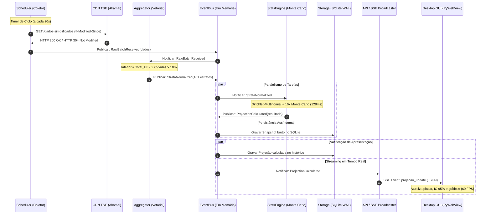

# Arquitetura Desacoplada e Modular do Sistema (SPETR)
## Padrões de Projeto, Separação de Responsabilidades e Interfaces

**Documento:** Arquitetura Modular e Contratos de Componentes  
**Versão:** 1.0.0  
**Data:** Outubro de 2026  
**Padrão Arquitetural:** Clean Architecture / Hexagonal (Ports & Adapters) + Event-Driven In-Process

---

## 1. Princípios Arquiteturais e Diretrizes de Desacoplamento

Para garantir que a aplicação seja extensível, fácil de testar isoladamente e independente de tecnologias de tela ou transporte de rede, o projeto segue quatro princípios estruturantes:

1. **Regra de Dependência Unidirecional (Clean Architecture):**
   * O **Núcleo Estatístico (Domain)** não conhece a existência de rede, SQLite, FastAPI, PyWebView ou qualquer biblioteca externa. É código matemático puro em Python e NumPy.
   * O **Coletor de Dados** apenas busca bytes e faz o parsing dos JSONs do TSE. Ele não sabe o que é uma Projeção Bayesiana e não se comunica com a interface.
   * A **Interface Gráfica (UI)** é um cliente consumidor de eventos. Se substituirmos PyWebView por PySide6, web browser comum ou CLI no terminal, o restante da aplicação permanece 100% inalterado.
2. **Barramento de Eventos Assíncrono (*In-Process Event Bus*):**
   * A comunicação entre os componentes é mediada por eventos (`dataclasses` imutáveis) trafegando em uma fila de mensagens em memória (`asyncio.Queue`).
   * Componentes não chamam métodos concretos uns dos outros; eles assinam e emitem eventos.
3. **Inversão de Dependência via Contratos (*Python Protocols / Interfaces*):**
   * O orquestrador depende apenas de interfaces abstratas (`ICollector`, `IProjectionEngine`, `IRepository`), permitindo plugar facilmente um coletor de teste (mock/replay) sem alterar uma única linha do motor de cálculo.
4. **Isolamento de Estado (State Isolation):**
   * O estado da apuração é mantido em memória em estruturas imutáveis protegidas contra concorrência (*thread-safe*). O banco SQLite atua como repositório de persistência e auditoria.

---

## 2. Estrutura de Diretórios do Projeto

```text
eleicao_projecao/
├── docs/                                  # Documentação técnica e especificações
│   ├── README.md                          # Índice geral da documentação
│   ├── guia_apuracao_tse.md               # Infraestrutura e endpoints do TSE
│   ├── modelo_estatistico_projecao.md     # Formulação matemática (Dirichlet / MC)
│   ├── especificacoes_do_sistema.md       # Requisitos do sistema (SRS)
│   └── arquitetura_de_modulos.md          # Este documento
│
├── spetr/                                 # Pacote raiz da aplicação
│   ├── __init__.py
│   │
│   ├── domain/                            # NÚCLEO PURO (Zero dependências externas)
│   │   ├── __init__.py
│   │   ├── entities.py                    # Estrato, Candidato, Voto, Snapshot
│   │   ├── interfaces.py                  # Protocols (ICollector, IEngine, IRepository)
│   │   └── value_objects.py               # Tipos de valor (UF, CódigoTSE, Percentual)
│   │
│   ├── stats_engine/                      # MOTOR MATEMÁTICO (NumPy / SciPy)
│   │   ├── __init__.py
│   │   ├── bayesian_dirichlet.py          # Atualização conjugada de parâmetros
│   │   ├── monte_carlo.py                 # Simulação estocástica vetorizada (10k)
│   │   ├── swing_model.py                 # Modelo do pêndulo e encolhimento
│   │   └── turnout.py                     # Estimativa dinâmica de comparecimento
│   │
│   ├── collector/                         # INGESTÃO E REDE (httpx / asyncio)
│   │   ├── __init__.py
│   │   ├── client.py                      # Cliente HTTP/2 com ETag e If-Modified-Since
│   │   ├── pacing.py                      # Controle de taxa (asyncio.Semaphore)
│   │   ├── parser.py                      # Parser dos JSONs do TSE
│   │   └── scheduler.py                   # Agendador de dois ritmos (Tiered Polling)
│   │
│   ├── aggregator/                        # ÁLGEBRA ESTRATIFICADA
│   │   ├── __init__.py
│   │   └── vector_subtraction.py          # Decomposição: Interior = Total - Σ Cidades
│   │
│   ├── storage/                           # PERSISTÊNCIA EMBUTIDA (SQLite nativo)
│   │   ├── __init__.py
│   │   ├── database.py                    # Conexão thread-safe (modo WAL)
│   │   ├── repository.py                  # Implementação de IRepository
│   │   └── schema.sql                     # Criação de tabelas e índices
│   │
│   ├── services/                          # ORQUESTRAÇÃO E EVENTOS
│   │   ├── __init__.py
│   │   ├── event_bus.py                   # Barramento de eventos assíncrono
│   │   ├── events.py                      # Definição dos eventos do sistema
│   │   └── pipeline_coordinator.py        # Orquestrador do ciclo analítico
│   │
│   ├── api/                               # SERVIÇOS DE REDE LOCAL (FastAPI)
│   │   ├── __init__.py
│   │   ├── server.py                      # Servidor em porta efêmera localhost
│   │   ├── routes.py                      # Rotas REST (/projecao/nacional, etc.)
│   │   └── sse_broadcaster.py             # Distribuidor Server-Sent Events
│   │
│   ├── ui/                                # APRESENTAÇÃO DESKTOP
│   │   ├── __init__.py
│   │   ├── window.py                      # Launcher nativo Desktop (PyWebView)
│   │   └── assets/                        # Frontend Web embutido (HTML/CSS/JS)
│   │       ├── index.html                 # Dashboard interativo
│   │       ├── css/style.css              # Estilos Tailwind CSS compilados
│   │       └── js/                        # Componentes de tela e gráficos
│   │           ├── app.js                 # Consumidor de SSE e renderizador
│   │           ├── charts.js              # Gráficos de incerteza (Apache ECharts)
│   │           └── map.js                 # Mapa interativo coroplético
│   │
│   └── data/                              # DADOS ESTÁTICOS PRÉ-CARREGADOS
│       ├── cidades_100k.json              # Mapeamento oficial dos 154 municípios
│       ├── ufs_metadados.json             # Eleitorado e histórico das 27 UFs
│       └── priors_eleicao.json            # Priors opcionais (vazio: média nacional observada)
│
├── tests/                                 # TESTES ISOLADOS POR MÓDULO
│   ├── unit/
│   │   ├── test_vector_subtraction.py
│   │   ├── test_bayesian_dirichlet.py
│   │   ├── test_monte_carlo.py
│   │   └── test_tse_parser.py
│   ├── mocks/                             # Dados simulados para testes offline
│   │   └── tse_mock_payloads.py
│   └── integration/
│       └── test_full_pipeline_replay.py
│
├── main.py                                # Ponto de entrada e bootstrap do Desktop
├── requirements.txt                       # Dependências de desenvolvimento
└── spetr.spec                             # Configuração de build do PyInstaller
```

---

## 3. Detalhamento e Fronteiras de Cada Módulo

### 3.1. Módulo `domain` (Entidades e Contratos Abstratos)
* **Responsabilidade:** Definir os objetos de negócio puros e os tipos que circulam no sistema.
* **O que PODE fazer:** Conter dataclasses, validações matemáticas simples, cálculos de proporções e interfaces (`Protocols`).
* **O que NÃO PODE fazer:** Não importa `httpx`, `sqlite3`, `fastapi`, `webview`, `numpy` ou qualquer biblioteca de terceiros.
* **Principais Entidades:**
  - `EstratoEleitoral`: Identificador, UF, nome, eleitores aptos, seções totais, prior.
  - `SnapshotParcial`: Seções apuradas, votos nominais, votos em branco, votos nulos.
  - `ResultadoProjecao`: Média projetada, limites inferior/superior do IC 95%, probabilidade de vitória, status de *Call Decision*.

### 3.2. Módulo `collector` (Ingestão de Dados e Pacing)
* **Responsabilidade:** Baixar com segurança e de forma escalonada os arquivos JSON do TSE.
* **Mecanismos Internos:**
  - `PacingManager`: Mantém um `asyncio.Semaphore(15)` e um limitador de taxa para nunca exceder 12 req/s.
  - `ConditionalCache`: Armazena os cabeçalhos `Last-Modified` e `ETag` de cada URL, enviando `If-Modified-Since`.
  - `Scheduler`: Coordena o *Tiered Polling* (UFs/Capitais a cada 15s; Cidades > 100k a cada 30s).
* **Saída:** Emite o evento `RawDataBatchReceived` contendo os dados brutos recebidos.

### 3.3. Módulo `aggregator` (Decomposição Vetorial)
* **Responsabilidade:** Executar a álgebra de conjuntos para purificar o interior dos estados.
* **Regra Matemática:**
  $$\text{Votos}_{\text{Interior Remanescente}} = \text{Votos}_{\text{UF}} - \sum_{c \in \text{Cidades > 100k}} \text{Votos}_{c}$$
* **Saída:** Converte os dados coletados em uma lista normalizada de **181 estratos independentes e homogêneos**, emitindo o evento `StrataNormalizedEvent`.

### 3.4. Módulo `stats_engine` (Motor Estatístico e Monte Carlo)
* **Responsabilidade:** Executar o modelo Dirichlet-Multinomial e a simulação estocástica de Monte Carlo.
* **Dependência Exclusiva:** `numpy` (para operações matriciais vetorizadas em C).
* **Fórmula Interna:**
  1. Atualiza $\boldsymbol{\alpha}_{\text{post}} = \boldsymbol{\alpha}_{\text{prior}} + \mathbf{y}_{\text{obs}}$ para cada um dos 181 estratos.
  2. Sorteia uma matriz de tamanho $(181 \times 10.000)$ de proporções de voto via `np.random.beta` / `np.random.dirichlet`.
  3. Projeta os votos faltantes de cada estrato e agrega a pirâmide nacional para as 10.000 eleições sintéticas.
  4. Extrai a média, o IC 95% $[P_{2.5}, P_{97.5}]$ e a probabilidade $P(\text{Vitória}_A > 50\%)$.
* **Saída:** Emite o evento `ProjectionCalculatedEvent`.

### 3.5. Módulo `storage` (Persistência e Auditoria)
* **Responsabilidade:** Gravação durável de cada snapshot e projeção em banco de dados embutido local.
* **Tecnologia:** SQLite nativo do Python configurado em modo **WAL (Write-Ahead Logging)**, permitindo que as leituras da UI nunca bloqueiem as gravações do coletor.
* **Funcionalidade Especial:** Fornece o serviço de *Time-Travel*, retornando o estado do sistema em qualquer instante pretérito da apuração.

### 3.6. Módulo `api` (Distribuição e Streaming Local)
* **Responsabilidade:** Servir os dados para a interface via HTTP REST e canal SSE (*Server-Sent Events*).
* **Configuração:** Roda em `localhost` em porta aleatória dinâmica (ex: `127.0.0.1:0`), sem expor portas para a internet.
* **Mecanismo SSE:** Mantém um conjunto de conexões ativas e envia um pacote JSON somente quando o evento `ProjectionCalculatedEvent` é publicado no barramento.

### 3.7. Módulo `ui` (Apresentação Desktop)
* **Responsabilidade:** Exibir a interface gráfica para o usuário final.
* **Tecnologia:** **PyWebView** carregando os assets locais (`spetr/ui/assets/index.html`).
* **Comunicação:** O JavaScript consome a rota local de SSE (`http://127.0.0.1:{porta}/api/v1/projecao/stream`) e renderiza os gráficos interativos via **Apache ECharts** e **Tailwind CSS**.

---

## 4. Diagrama de Sequência e Fluxo de Eventos

O diagrama a seguir ilustra o ciclo analítico completo que ocorre a cada 15-20 segundos:



---

## 5. Contratos de Código (Interfaces e Eventos em Python)

Para assegurar o desacoplamento formal em tempo de desenvolvimento, definem-se os contratos via `typing.Protocol`:

### 5.1. Contrato do Motor Estatístico (`domain/interfaces.py`)
```python
from typing import Protocol, Dict, List
from spetr.domain.entities import EstratoEleitoral, ResultadoProjecao

class IProjectionEngine(Protocol):
    """Contrato abstrato que qualquer motor estatístico deve cumprir."""
    
    def inicializar_estratos(self, estratos: List[EstratoEleitoral]) -> None:
        """Carrega a configuração dos estratos e priors."""
        ...

    def calcular(
        self, 
        dados_apurados: Dict[str, Dict[str, any]], 
        num_simulacoes: int = 10000
    ) -> ResultadoProjecao:
        """Executa a projeção e devolve os intervalos probabilísticos."""
        ...
```

### 5.2. Definição dos Eventos do Barramento (`services/events.py`)
```python
from dataclasses import dataclass
from typing import Dict, Any
from spetr.domain.entities import ResultadoProjecao

@dataclass(frozen=True)
class RawBatchReceivedEvent:
    timestamp: str
    arquivos_atualizados: int
    payload_bruto: Dict[str, Any]

@dataclass(frozen=True)
class StrataNormalizedEvent:
    timestamp: str
    estratos_dados: Dict[str, Dict[str, Any]]  # 181 estratos prontos

@dataclass(frozen=True)
class ProjectionCalculatedEvent:
    timestamp: str
    ciclo_id: int
    resultado: ResultadoProjecao
```

### 5.3. O Barramento Assíncrono Desacoplado (`services/event_bus.py`)
```python
import asyncio
from typing import Callable, Dict, List, Type, Any

class EventBus:
    """Barramento de eventos in-process desacoplado."""
    
    def __init__(self):
        self._subscribers: Dict[Type, List[Callable]] = {}

    def subscribe(self, event_type: Type, handler: Callable):
        if event_type not in self._subscribers:
            self._subscribers[event_type] = []
        self._subscribers[event_type].append(handler)

    async def publish(self, event: Any):
        event_type = type(event)
        if event_type in self._subscribers:
            # Executa todos os handlers inscritos concorrentemente
            tasks = [handler(event) for handler in self._subscribers[event_type]]
            await asyncio.gather(*tasks)
```

---

## 6. Estratégia de Testabilidade Isolada

Com essa arquitetura desacoplada, os testes são completamente independentes e não necessitam de rede nem de banco de dados:

1. **Testando o Motor Estatístico (`tests/unit/test_monte_carlo.py`):**
   * Não precisa de internet nem de interface gráfica.
   * Cria-se uma lista de 3 estratos sintéticos (ex: o caso Paraíba), injetam-se votos fictícios e valida-se se a média projetada e os percentis do IC 95% estão dentro da tolerância esperada em menos de 20 milissegundos.
2. **Testando o Coletor de Rede (`tests/unit/test_collector.py`):**
   * Utiliza-se a biblioteca `respx` ou `unittest.mock` para simular as respostas da CDN do TSE (inclusive testando se o coletor lida corretamente com status HTTP 304, 404 e 503).
   * Valida se o limitador de taxa (`asyncio.Semaphore`) impede que mais de 15 requisições saiam ao mesmo tempo.
3. **Testando o Subtrator Vetorial (`tests/unit/test_vector_subtraction.py`):**
   * Alimenta-se a função com os dados de Campina Grande, João Pessoa e o total da Paraíba.
   * Valida-se matematicamente se:
     $$\text{Seções}_{\text{Resto da PB}} == \text{Seções}_{\text{Total PB}} - \text{Seções}_{\text{JP}} - \text{Seções}_{\text{CG}}$$
4. **Teste de Replay da Eleição Completa (`tests/integration/test_full_pipeline_replay.py`):**
   * Um mock injeta no `EventBus` os 50 lotes oficiais da eleição de 2022 em velocidade acelerada (1 lote a cada 100ms).
   * O pipeline executa do início ao fim e valida se o resultado convergiu perfeitamente para o resultado histórico oficial do TSE.

---

## 7. Inicialização da Aplicação Desktop (`main.py`)

O ponto de entrada da aplicação apenas monta a árvore de dependências e inicia o loop principal da janela desktop:

```python
"""
main.py
Bootstrap da Aplicação Desktop SPETR
"""
import sys
import asyncio
import threading
import uvicorn
import webview

from spetr.services.event_bus import EventBus
from spetr.collector.scheduler import TieredScheduler
from spetr.aggregator.vector_subtraction import VectorAggregator
from spetr.stats_engine.monte_carlo import MonteCarloProjectionEngine
from spetr.storage.database import SQLiteDatabase
from spetr.storage.repository import ElectionRepository
from spetr.api.server import create_api_app
from spetr.ui.window import DesktopWindow

def rodar_servidor_e_worker(loop, bus, scheduler, api_app, porta):
    """Thread em segundo plano que executa a API e o worker analítico."""
    asyncio.set_event_loop(loop)
    
    # Inicia o servidor local FastAPI em porta dinâmica
    config = uvicorn.Config(api_app, host="127.0.0.1", port=porta, log_level="warning")
    server = uvicorn.Server(config)
    
    loop.create_task(server.serve())
    loop.create_task(scheduler.iniciar_loop())
    loop.run_forever()

def main():
    print("Iniciando Sistema de Projeção Eleitoral (SPETR Desktop)...")

    # 1. Instanciação dos Componentes Desacoplados
    bus = EventBus()
    db = SQLiteDatabase("spetr_eleicoes.sqlite")
    repo = ElectionRepository(db)
    aggregator = VectorAggregator(bus)
    engine = MonteCarloProjectionEngine(bus, num_simulacoes=10000)
    scheduler = TieredScheduler(bus)
    
    porta_local = 48291
    api_app = create_api_app(bus, repo)

    # 2. Inicia o Worker em Thread Separada (UI permanece a 60 FPS)
    loop_worker = asyncio.new_event_loop()
    thread_worker = threading.Thread(
        target=rodar_servidor_e_worker,
        args=(loop_worker, bus, scheduler, api_app, porta_local),
        daemon=True
    )
    thread_worker.start()

    # 3. Inicia a Janela Nativa Desktop (PyWebView)
    janela = DesktopWindow(
        titulo="SPETR - Painel de Projeção Eleitoral em Tempo Real",
        url_local=f"http://127.0.0.1:{porta_local}/index.html",
        largura=1366,
        altura=768
    )
    janela.exibir()

    sys.exit(0)

if __name__ == "__main__":
    main()
```
