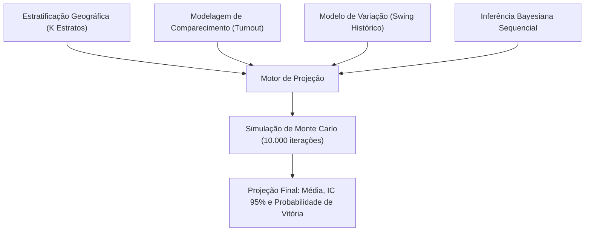

# Ciência Estatística e Modelagem de Projeção de Apuração Eleitoral em Tempo Real

Este documento detalha o embasamento matemático, a formulação estatística e a arquitetura algorítmica para calcular **projeções probabilísticas do resultado final de eleições** a cada atualização parcial divulgada pelo Tribunal Superior Eleitoral (TSE).

---

## Sumário

1. [O Problema Estatístico: O Viés de Não-Aleatoriedade](#1-o-problema-estatístico-o-viés-de-não-aleatoriedade)
2. [Abordagens Matemáticas Fundamentais](#2-abordagens-matemáticas-fundamentais)
   - [2.1. Pós-Estratificação Espacial (Stratified Estimation)](#21-pós-estratificação-espacial-stratified-estimation)
   - [2.2. A Decomposição em Três Níveis (Capital, Cidades-Pólo e Interior Remanescente)](#22-a-decomposição-em-três-níveis-capital-cidades-pólo-e-interior-remanescente)
   - [2.3. Modelagem Dinâmica de Comparecimento (Turnout)](#23-modelagem-dinâmica-de-comparecimento-turnout)
   - [2.4. O Modelo do Pêndulo (Swing Model)](#24-o-modelo-do-pêndulo-swing-model)
   - [2.5. Atualização Bayesiana Sequencial (Dirichlet-Multinomial)](#25-atualização-bayesiana-sequencial-dirichlet-multinomial)
3. [Quantificação de Incerteza e Simulação de Monte Carlo](#3-quantificação-de-incerteza-e-simulação-de-monte-carlo)
4. [Critérios para Decisão de Vitória (Decision Desk "Call")](#4-critérios-para-decisão-de-vitória-decision-desk-call)
5. [Algoritmo Passo a Passo de Atualização em Tempo Real](#5-algoritmo-passo-a-passo-de-atualização-em-tempo-real)
   - [5.1. Engenharia de Rede, Pacing Contínuo e Taxa Ótima de Polling](#51-engenharia-de-rede-pacing-contínuo-e-taxa-ótima-de-polling)
6. [Implementação de Referência em Python (Simulador Numérico com Exemplo Paraíba 3-Níveis)](#6-implementação-de-referência-em-python-simulador-numérico)
7. [Caso de Estudo: A Dinâmica da "Virada Prevista" e o Fenômeno Paraíba](#7-caso-de-estudo-a-dinâmica-da-virada-prevista)

---

## 1. O Problema Estatístico: O Viés de Não-Aleatoriedade

O erro mais comum cometido por analistas amadores é a **extrapolação linear ingênua**:
$$\hat{P}_A = \frac{\text{Votos Observados de } A}{\text{Total de Votos Apurados até o Momento}}$$

Essa fórmula só seria estatisticamente válida se as urnas chegassem em uma **Amostra Aleatória Simples (AAS)** com distribuição uniforme no tempo. Porém, na realidade eleitoral, a apuração é regida por um **viés sistemático de chegada**:

1. **Heterogeneidade Geográfica e de Infraestrutura:** 
   - Seções de áreas urbanas digitalmente densas ou pequenos municípios apuram com velocidades muito distintas de zonas periféricas de metrópoles, áreas rurais ou regiões com conexões satelitais.
   - No Brasil, historicamente, estados do Sul, Centro-Oeste e Sudeste (interior de SP) costumam concluir a transmissão de dados mais rapidamente que certos colégios eleitorais do Norte e Nordeste.
2. **Correlação Espacial do Voto:**
   - Eleitores em um mesmo estrato geográfico possuem correlações socioeconômicas e políticas elevadas.
   - Como resultado, se as primeiras urnas vierem de redutos favoráveis ao Candidato $X$, ele abrirá uma vantagem fictícia inicial (fenômeno conhecido internacionalmente como *"miragem eleitoral"*).

> **A missão da ciência estatística:** Descontar o viés da ordem de chegada e estimar com precisão o comportamento dos **votos ainda não apurados**, atualizando a distribuição preditiva final a cada novo snapshot recebido da CDN do TSE.

---

## 2. Abordagens Matemáticas Fundamentais

Um sistema profissional de projeção combina quatro pilares estatísticos:



---

### 2.1. Pós-Estratificação Espacial (Stratified Estimation)

Divide-se o colégio eleitoral em $K$ estratos disjuntos. No caso de uma eleição presidencial, a estratificação ideal ocorre por **Município** ($K \approx 5.570$) ou por **Zona Eleitoral** ($K \approx 3.000$). Para simplificação computacional, pode-se usar **Microrregiões/Mesorregiões** ou **Estados (UFs)** ($K = 27$).

Para cada estrato $k \in \{1, \dots, K\}$:
* $N_k$: Total de eleitores cadastrados e aptos (dado oficial público prévio do TSE).
* $S_k$: Total de seções eleitorais do estrato.
* $s_k^{\text{obs}}(t)$: Seções já totalizadas até o instante $t$.
* $v_{i, k}^{\text{obs}}(t)$: Votos apurados para o candidato $i$ no estrato $k$.
* $V_k^{\text{obs}}(t) = \sum_{i} v_{i, k}^{\text{obs}}(t)$: Total de votos válidos já apurados no estrato $k$.

O total final de votos projetados para o candidato $i$ em todo o país é a soma do que já foi apurado com a expectativa do que falta apurar:

$$\hat{V}_i^{\text{final}} = \sum_{k=1}^K v_{i, k}^{\text{obs}} + \sum_{k=1}^K \hat{V}_k^{\text{rem}} \cdot \hat{p}_{i, k}^{\text{rem}}$$

Onde:
* $\hat{V}_k^{\text{rem}}$ é a estimativa de quantos votos válidos **ainda faltam ser contados** no estrato $k$.
* $\hat{p}_{i, k}^{\text{rem}}$ é a proporção projetada de votos que o candidato $i$ receberá nos votos restantes do estrato $k$.

---

### 2.2. A Decomposição em Três Níveis (Capital, Cidades-Pólo e Interior Remanescente)

A simples dicotomia "Capital vs. Interior" (`Interior = Total - Capital`) representa um avanço expressivo sobre a média global, mas ainda esconde **heterogeneidades regionais críticas**. Na teoria estatística de amostragem estratificada (Cochran, 1977), a variância de um estimador global é dada por:

$$Var(\hat{Y}) = \sum_{h=1}^H W_h^2 \frac{S_h^2}{n_h} (1 - f_h)$$

Onde $S_h^2$ é a **variância intra-estrato** (a dispersão interna do comportamento do voto dentro daquele grupo). 
* Se um estrato agrupa cidades com comportamentos políticos antagônicos, $S_h^2$ explode, contaminando a projeção com ruído excessivo nas primeiras fases da apuração.
* Se subdividirmos o estrato isolando os núcleos divergentes, $S_h^2$ cai drasticamente em cada subgrupo, acelerando a convergência matemática da projeção.

#### 1. A Prova Real: O Caso Paraíba (João Pessoa, Campina Grande e Resto da PB)
No 2º turno presidencial de 2022, a Paraíba ilustrou perfeitamente esse fenômeno:

* **João Pessoa (Capital):** Disputa equilibrada (Lula ~53,9% vs Bolsonaro ~46,1%).
* **Campina Grande (2º maior colégio eleitoral):** **Vitória de Bolsonaro** (Bolsonaro ~51,5% vs Lula ~48,5%).
* **Resto da Paraíba (Sertão, Curimataú, Brejo - 221 cidades):** **Lula com votação esmagadora** (~72% a 85%).

**A Armadilha do Agrupamento Ingênuo:** 
Como Campina Grande possui excelente infraestrutura de transmissão eleitoral, suas seções costumam totalizar com maior velocidade que as pequenas cidades do Sertão. Se o modelo calcular apenas `Interior(PB) = Total(PB) - João Pessoa`, o "Interior" parecerá artificialmente pró-Bolsonaro até os momentos finais da apuração, gerando oscilações violentas e falsas impressões de vitória.

Ao desmembrar em **3 estratos**:
$$\text{Interior Remanescente}(PB) = \text{Total}(PB) - \text{João Pessoa} - \text{Campina Grande}$$
a variância interna do "Resto da PB" se torna homogênea, estabilizando a projeção logo nos primeiros 15% a 20% das urnas.

#### 2. Mapeamento Nacional dos Pólos Heterogêneos
Esse padrão se repete sistematicamente em todos os principais colégios eleitorais do país:

| Estado | Capital | Cidades-Pólo / Hubs Regionais | Interior Remanescente |
| :--- | :--- | :--- | :--- |
| **São Paulo** | Capital (Serviços / Disputado) | Cinturão Metropolitano (Guarulhos/ABC/Osasco) + Hubs do Agro/Tecnologia (Campinas, Ribeirão Preto, SJC, Sorocaba) | Interior profundo e pequenos municípios |
| **Minas Gerais** | Belo Horizonte | Triângulo Mineiro (Uberlândia/Uberaba) + Sul de Minas + Vale do Aço / Norte (Montes Claros - semiárido) | Pequenos municípios de perfil agro ou rural |
| **Santa Catarina** | Florianópolis (Universitária/Serviços) | **Joinville** (maior que a capital, fortemente industrial) + Blumenau / Vale do Itajaí | Oeste / Planalto Serrano |
| **Bahia** | Salvador (Centro metropolitano) | Feira de Santana + Vitória da Conquista | Semiárido e Recôncavo |
| **Pernambuco** | Recife | RMR (Jaboatão, Olinda) + Agreste (Caruaru) + Sertão do São Francisco (Petrolina) | Sertão tradicional e Zona da Mata |
| **Paraná** | Curitiba | Norte Central (Londrina, Maringá) + Oeste (Cascavel, Foz do Iguaçu) | Municípios agrícolas remanescentes |
| **Rio Grande do Sul**| Porto Alegre | Serra Gaúcha (Caxias do Sul) + Metade Sul (Pelotas/Bagé) + Noroeste Missioneiro | Pequenos municípios agropecuários |

#### 3. Viabilidade Técnica e Granularidade Ótima: A Regra dos 100 Mil Eleitores
Para maximizar a precisão da projeção mantendo-se estritamente abaixo do **limite de 100 req/s da CDN do TSE**, o critério de corte ideal no Brasil é monitorar todos os **municípios com mais de 100 mil eleitores**:

* No Brasil, existem aproximadamente **154 municípios** com mais de 100 mil eleitores.
* Essas 154 cidades concentram **mais de 53% de todo o eleitorado nacional**.
* Nos estados menores (AC, AP, RR, TO, SE), onde frequentemente só a capital ultrapassa 100 mil eleitores, o modelo converte-se automaticamente e de forma elegante em `Capital + Interior`, sem desperdício de requisições.
* Nos estados maiores (SP, MG, RJ, BA, PR, RS, PE), o modelo captura cirurgicamente os grandes pólos industriais e do agronegócio que votam de forma antagônica à capital.

#### A Pirâmide Hierárquica de Consolidação (4 Níveis):
```
[ NÍVEL 1: CIDADES > 100K DA UF ]              [ NÍVEL 2: INTERIOR REMANESCENTE ]
  - Cidade A (>100k)                              - Total(UF) - Soma(Cidades > 100k)
  - Cidade B (>100k)                                (Interior rural e pequenas cidades)
         │                                                        │
         └──────────────────────────┬─────────────────────────────┘
                                    │
                                    v
                     [ NÍVEL 3: CONSOLIDADO DA UF ]
                       (Soma ponderada dos estratos)
                                    │
                                    v
                    [ NÍVEL 4: CONSOLIDADO BRASIL ]
                     (Soma dos 27 Estados Projetados)
```

#### A Álgebra das Requisições:
* 27 requisições de UFs (totais consolidados)
* ~154 requisições de cidades com mais de 100 mil eleitores
* **Total por ciclo de apuração:** $\approx \mathbf{181 \text{ requisições}}$.

Se o worker executar um ciclo a cada 20 segundos:
$$\text{Taxa Média de Chamadas} = \frac{181}{20} \approx \mathbf{9,0 \text{ requisições/segundo}}$$

Isso consome **menos de 10% da capacidade máxima permitida pelo TSE** (100 req/s), permite atualizar toda a matriz em ~2,5 segundos via requisições assíncronas e deixa o interior remanescente tão homogêneo que o erro residual da projeção colapsa com apenas 10% a 15% das urnas apuradas.

#### Fórmula Geral da Álgebra Vetorial:
Para qualquer UF onde se monitore o conjunto de cidades $\mathcal{C}_{UF} = \{c \mid \text{Eleitores}_c \ge 100.000\}$:
$$\text{Votos}_{i, \text{Interior Rem}}(UF) = \text{Votos}_{i, \text{Total}}(UF) - \sum_{c \in \mathcal{C}_{UF}} \text{Votos}_{i, c}(UF)$$
$$\text{Seções}_{\text{Interior Rem}}(UF) = \text{Seções}_{\text{Total}}(UF) - \sum_{c \in \mathcal{C}_{UF}} \text{Seções}_{c}(UF)$$

---

### 2.3. Modelagem Dinâmica de Comparecimento (Turnout)

O total de votos a serem emitidos em um estrato não é constante; ele depende da taxa de comparecimento (ou abstenção). Conforme as seções do estrato $k$ apuram, a taxa de comparecimento local converge.

Estimamos o total de votos válidos finais esperados no estrato $k$ ($\hat{V}_k^{\text{tot}}$) combinando o histórico do estrato com o comportamento observado nas seções apuradas:

$$\hat{T}_k(t) = \lambda_k(t) \cdot T_k^{\text{obs}}(t) + (1 - \lambda_k(t)) \cdot T_k^{\text{hist}}$$

Onde:
* $T_k^{\text{hist}}$ é a taxa de comparecimento de votos válidos do estrato em pleitos equivalentes anteriores.
* $T_k^{\text{obs}}(t)$ é a taxa de comparecimento observada nas seções já totalizadas no instante $t$.
* $\lambda_k(t) = \frac{s_k^{\text{obs}}(t)}{S_k}$ é a fração de seções apuradas no estrato.

Portanto, o número de votos restantes a serem totalizados no estrato $k$ é:
$$\hat{V}_k^{\text{rem}}(t) = \max\left(0, \; N_k \cdot \hat{T}_k(t) - V_k^{\text{obs}}(t)\right)$$

---

### 2.4. O Modelo do Pêndulo (Swing Model)

Mesmo quando um estrato tem pouquíssimas urnas abertas (por exemplo, 2% em Salvador), o percentual de votos não é arbitrário. Nós conhecemos a base histórica desse mesmo estrato na eleição anterior ($p_{i, k}^{\text{base}}$).

O **Swing** (ou Pêndulo) representa a variação percentual que o eleitorado daquele estrato apresentou em relação ao histórico de referência:

$$\Delta_{i, k}^{\text{obs}}(t) = p_{i, k}^{\text{obs}}(t) - p_{i, k}^{\text{base}}$$

#### Encolhimento Bayesiano (Shrinkage / Empirical Bayes)
Se o estrato tem apenas 1 urna apurada, $\Delta_{i, k}^{\text{obs}}$ é altamente volátil (ruído amostral). Se o estrato tem 90% apurado, $\Delta_{i, k}^{\text{obs}}$ é muito confiável.

Utiliza-se o estimador com contração para a média regional/macro ($\bar{\Delta}_{i, \text{macro}}$):

$$\hat{\Delta}_{i, k}(t) = w_k(t) \cdot \Delta_{i, k}^{\text{obs}}(t) + (1 - w_k(t)) \cdot \bar{\Delta}_{i, \text{macro}}(t)$$

Onde o peso de credibilidade $w_k(t)$ cresce com o avanço da apuração no estrato:
$$w_k(t) = \frac{s_k^{\text{obs}}(t)}{s_k^{\text{obs}}(t) + M_0}$$
*(onde $M_0$ é uma constante de suavização, tipicamente entre 10 e 30 seções).*

A proporção esperada para os votos que faltam no estrato é:
$$\hat{p}_{i, k}^{\text{rem}}(t) = \text{clip}\left(p_{i, k}^{\text{base}} + \hat{\Delta}_{i, k}(t), \; 0, \; 1\right)$$

---

### 2.5. Atualização Bayesiana Sequencial (Dirichlet-Multinomial)

Para eleições com múltiplos candidatos (ou segundo turno com dois candidatos), a abordagem estatisticamente rigorosa para modelar a incerteza é o modelo conjugado **Dirichlet-Multinomial**.

Seja o vetor de proporções de voto no estrato $k$:
$$\boldsymbol{\theta}_k = (\theta_{1, k}, \theta_{2, k}, \dots, \theta_{C, k}), \quad \sum_{i=1}^C \theta_{i, k} = 1$$

#### 1. Distribuição *A Priori* (Antes da Apuração Começar):
Definida a partir de pesquisas eleitorais consolidadas e resultados do 1º turno:
$$\boldsymbol{\theta}_k \sim \text{Dirichlet}(\boldsymbol{\alpha}_k)$$
$$\boldsymbol{\alpha}_k = (\alpha_{1, k}, \alpha_{2, k}, \dots, \alpha_{C, k})$$

Onde $\alpha_{i, k} = \kappa \cdot p_{i, k}^{\text{prior}}$, sendo $\kappa$ o tamanho de amostra equivalente da *prior* (grau de confiança inicial, por exemplo $\kappa = 500$ votos).

#### 2. Função de Verossimilhança (Likelihood):
Conforme os votos observados $\mathbf{y}_k(t) = (v_{1, k}^{\text{obs}}, v_{2, k}^{\text{obs}}, \dots, v_{C, k}^{\text{obs}})$ chegam da CDN do TSE:
$$\mathbf{y}_k \mid \boldsymbol{\theta}_k \sim \text{Multinomial}\left(V_k^{\text{obs}}, \; \boldsymbol{\theta}_k\right)$$

#### 3. Distribuição *A Posteriori*:
Pela propriedade da família conjugada Dirichlet-Multinomial, a distribuição posteriori de $\boldsymbol{\theta}_k$ no instante $t$ é analiticamente exata:
$$\boldsymbol{\theta}_k \mid \mathbf{y}_k(t) \sim \text{Dirichlet}(\boldsymbol{\alpha}_k + \mathbf{y}_k(t))$$

#### Propriedade de Convergência do Modelo:
A média posteriori esperada para os votos restantes é:
$$\mathbb{E}[\theta_{i, k} \mid \mathbf{y}_k] = \frac{\alpha_{i, k} + v_{i, k}^{\text{obs}}}{\sum_{j=1}^C (\alpha_{j, k} + v_{j, k}^{\text{obs}})}$$

* Quando a apuração inicia ($v^{\text{obs}} = 0$): $\mathbb{E}[\theta] = \frac{\alpha}{\sum \alpha} = p^{\text{prior}}$.
* À medida que os votos reais chegam aos milhares ($v^{\text{obs}} \gg \alpha$): a influência do *prior* desaparece e a distribuição converge exatamente para a proporção real contada.

---

## 3. Quantificação de Incerteza e Simulação de Monte Carlo

Uma projeção pontual (número único) é insuficiente em eleições acirradas. É obrigatório mensurar a incerteza estatística gerando uma **distribuição de probabilidade preditiva completa**.

Em cada atualização de dados da apuração do TSE:

1. Executa-se um processo de simulação de Monte Carlo com $M = 10.000$ iterações.
2. Em cada iteração $m \in \{1, \dots, M\}$:
   - Para cada estrato $k$, sorteia-se um vetor de probabilidades de voto:
     $$\boldsymbol{\theta}_k^{(m)} \sim \text{Dirichlet}(\boldsymbol{\alpha}_k + \mathbf{y}_k(t))$$
   - Sorteia-se o comparecimento restante:
     $$\hat{V}_k^{\text{rem}, (m)} \sim \text{Normal}\left(\hat{V}_k^{\text{rem}}, \; \sigma_{V_k}^2\right)$$
   - Simulam-se os votos que faltam no estrato:
     $$\mathbf{v}_k^{\text{rem}, (m)} \sim \text{Multinomial}\left(\hat{V}_k^{\text{rem}, (m)}, \; \boldsymbol{\theta}_k^{(m)}\right)$$
   - Totalizam-se os votos nacionais simulados para cada candidato $i$:
     $$V_i^{(m)} = v_{i}^{\text{apurado}}(t) + \sum_{k=1}^K v_{i, k}^{\text{rem}, (m)}$$
   - Calcula-se a porcentagem final simulada:
     $$P_i^{(m)} = \frac{V_i^{(m)}}{\sum_j V_j^{(m)}} \times 100$$

A partir dos $10.000$ resultados simulados $\{P_i^{(1)}, \dots, P_i^{(M)}\}$, extraem-se:
* **Projeção Média / Mediana:** $\hat{P}_i = \text{Mediana}(P_i)$
* **Intervalo de Credibilidade de 95% (IC 95%):** Percentil 2.5% até Percentil 97.5%.
* **Probabilidade de Vitória do Candidato $A$:**
  $$P(\text{Vitória}_A) = \frac{1}{M} \sum_{m=1}^M \mathbb{I}\left(P_A^{(m)} > 50.0\%\right)$$

---

## 4. Critérios para Decisão de Vitória (Decision Desk "Call")

Quando uma redação de jornalismo de dados ou sistema analítico pode declarar formalmente que um candidato está "estatisticamente eleito" antes do fim oficial do TSE?

O critério estatístico de segurança exige três condições simultâneas:

1. **Probabilidade de Vitória Conclusiva:**
   $$P(\text{Vitória}_A) \ge 99.5\%$$
2. **Intervalo de Credibilidade Descolado:**
   O limite inferior do IC de 95% do Candidato $A$ deve ser estritamente superior a $50,00\%$:
   $$\text{Percentil}_{2.5\%}(P_A) > 50.00\%$$
3. **Teste de Sensibilidade Extrema (Worst-Case Scenario):**
   Mesmo se atribuirmos ao Candidato $B$ uma vantagem extrema e improvável nos votos restantes ($\mu_{B}^{\text{rem}} + 3\sigma$), a probabilidade de virada ainda precisa ser nula ou residual.

---

## 5. Algoritmo Passo a Passo de Atualização em Tempo Real

A cada novo ciclo em que o worker backend detecta mudança no cabeçalho ou na chave `hg` (hora de geração) do JSON do TSE:

```
[Início do Ciclo de Atualização]
  │
  ├── 1. Ler arquivo JSON do TSE
  │
  ├── 2. Para cada estrato k (UF ou Município):
  │        ├── Obter votos observados: v_{i,k}
  │        ├── Obter seções totalizadas: st_k e total s_k
  │        ├── Atualizar taxa de comparecimento e calcular votos restantes: V_k^rem
  │        └── Atualizar parâmetros de Dirichlet: alpha_k_post = alpha_k_prior + v_{k}^obs
  │
  ├── 3. Rodar 10.000 iterações de Monte Carlo:
  │        ├── Sortear proporções restantes: theta_k ~ Dirichlet(alpha_k_post)
  │        ├── Projetar votos faltantes de cada estrato
  │        └── Consolidar resultado nacional da iteração
  │
  ├── 4. Extrair métricas estatísticas:
  │        ├── Projeção pontual (% esperado de cada candidato)
  │        ├── Intervalo de credibilidade [2.5%, 97.5%]
  │        └── Probabilidade matemática de vitória
  │
  ├── 5. Emitir novo payload JSON de projeção via WebSockets/SSE para o Frontend
  │
[Aguardar próximo polling do TSE (15-20s)]
```

---

### 5.1. Engenharia de Rede, Pacing Contínuo e Taxa Ótima de Polling

O principal gargalo para manter atualizações constantes não é a largura de banda do servidor, mas a **política de segurança (WAF) do TSE** e o **ciclo de geração do cache da CDN (Akamai)**.

#### 1. A Relação Ótima de Requisições:
* **Intervalo por arquivo:** **15 a 20 segundos**. (Bater mais rápido que isso é contraproducente, pois a CDN do TSE possui `Cache-Control: max-age` de 15 a 60s, retornando dados cacheados idênticos).
* **Taxa Média Contínua:** **10 a 15 requisições por segundo**, distribuídas uniformemente.

#### 2. Pacing Contínuo vs. Rajada (*Thundering Herd*):
* **O Erro que Gera Ban:** Disparar todos os 181 arquivos no mesmo milissegundo. A taxa instantânea bate 181 req/s, estourando o teto de 100 req/s do TSE e gerando bloqueio temporário de 10 minutos.
* **A Prática Correta:** Utilizar um semáforo de concorrência (`asyncio.Semaphore(15)`) para transformar a coleta em um fluxo contínuo de ~10 a 12 req/s, sem picos abruptos.

#### 3. Polling em Dois Ritmos (Tiered Polling):
Nem todas as cidades precisam do mesmo ritmo de consulta:
* **Camada 1 (Macro & Capitais - ~55 arquivos):** 27 UFs + 27 Capitais $\to$ Consulta a cada **12 a 15 segundos** (~4,5 req/s). Mantém o placar geral sempre ultra-atualizado.
* **Camada 2 (Pólos Regionais > 100k - ~125 cidades):** Consulta a cada **25 a 30 segundos** (~5,0 req/s). Calibra o interior com estabilidade.
* **Taxa Total Combinada:** $\approx \mathbf{9,5 \text{ requisições/segundo}}$ (menos de 10% do limite).

#### 4. Otimização com `If-Modified-Since` (HTTP 304 Not Modified):
Ao armazenar o cabeçalho `Last-Modified` retornado pela CDN do TSE e reenviá-lo no cabeçalho `If-Modified-Since`:
* Se o arquivo ainda não foi recalculado pelo TSE, a CDN responde imediatamente com status **`304 Not Modified`** (pacote de ~100 bytes, latência < 30ms, sem download de payload).
* Se o arquivo mudou, o TSE responde **`200 OK`** com o JSON novo.
* Reduz em até 85% o tráfego de dados e o processamento de CPU do backend.

---

## 6. Implementação de Referência em Python (Simulador Numérico)

Abaixo está um módulo Python autossuficiente que implementa o modelo estratificado de projeção bayesiana com simulação de Monte Carlo:

```python
"""
engine_projecao.py
Módulo de Projeção Estatística Eleitoral em Tempo Real
"""

import numpy as np
from dataclasses import dataclass
from typing import List, Dict, Tuple

@dataclass
class EstratoEleitoral:
    nome: str
    eleitores_aptos: int
    comparecimento_historico: float  # Ex: 0.80 para 80%
    prior_candidato_a: float          # Ex: 0.52 para 52%
    peso_prior: float = 200.0         # Amostra virtual do prior

class MotorProjecaoEleitoral:
    def __init__(self, estratos: List[EstratoEleitoral]):
        self.estratos = estratos

    def calcular_projecao(
        self,
        dados_apuracao: Dict[str, Dict[str, float]],
        num_simulacoes: int = 10000
    ) -> Dict[str, any]:
        """
        Recebe os dados apurados por estrato e calcula a projeção final.
        dados_apuracao = {
            'SP': {'secoes_pct': 0.45, 'votos_a': 1200000, 'votos_b': 1000000},
            ...
        }
        """
        votos_totais_apurados_a = 0
        votos_totais_apurados_b = 0
        
        simulacoes_finais_a = np.zeros(num_simulacoes)
        simulacoes_finais_b = np.zeros(num_simulacoes)

        for est in self.estratos:
            dados = dados_apuracao.get(est.nome, {
                'secoes_pct': 0.0,
                'votos_a': 0,
                'votos_b': 0
            })

            v_a_obs = dados['votos_a']
            v_b_obs = dados['votos_b']
            pct_apurado = dados['secoes_pct']

            votos_totais_apurados_a += v_a_obs
            votos_totais_apurados_b += v_b_obs

            # Estimativa de votos válidos totais esperados para o estrato
            votos_esperados_estrato = est.eleitores_aptos * est.comparecimento_historico
            votos_observados_estrato = v_a_obs + v_b_obs

            # Votos restantes a serem apurados no estrato
            votos_restantes = max(0, int(votos_esperados_estrato - votos_observados_estrato))

            # Atualização Bayesiana: Prior Dirichlet (Beta para 2 candidatos) + Dados
            alpha_a = (est.prior_candidato_a * est.peso_prior) + v_a_obs
            alpha_b = ((1.0 - est.prior_candidato_a) * est.peso_prior) + v_b_obs

            # Amostragem da distribuição Beta posterior para a proporção restante
            proporcoes_simuladas_a = np.random.beta(alpha_a, alpha_b, size=num_simulacoes)

            # Projeção dos votos restantes no estrato
            votos_sim_restantes_a = proporcoes_simuladas_a * votos_restantes
            votos_sim_restantes_b = (1.0 - proporcoes_simuladas_a) * votos_restantes

            simulacoes_finais_a += v_a_obs + votos_sim_restantes_a
            simulacoes_finais_b += v_b_obs + votos_sim_restantes_b

        # Percentuais finais simulados para cada iteração
        total_votos_sim = simulacoes_finais_a + simulacoes_finais_b
        pct_simulados_a = (simulacoes_finais_a / total_votos_sim) * 100.0
        pct_simulados_b = (simulacoes_finais_b / total_votos_sim) * 100.0

        # Estatísticas descritivas dos resultados
        projecao_media_a = float(np.mean(pct_simulados_a))
        projecao_media_b = float(np.mean(pct_simulados_b))

        ic_a = (float(np.percentile(pct_simulados_a, 2.5)), float(np.percentile(pct_simulados_a, 97.5)))
        ic_b = (float(np.percentile(pct_simulados_b, 2.5)), float(np.percentile(pct_simulados_b, 97.5)))

        probabilidade_vitoria_a = float(np.mean(pct_simulados_a > 50.0) * 100.0)

        # Apuração real atual consolidada (números brutos)
        total_real_atual = votos_totais_apurados_a + votos_totais_apurados_b
        pct_real_atual_a = (votos_totais_apurados_a / total_real_atual * 100.0) if total_real_atual > 0 else 0.0

        return {
            "apurado_bruto": {
                "candidato_a_pct": round(pct_real_atual_a, 2),
                "candidato_b_pct": round(100.0 - pct_real_atual_a, 2),
                "total_votos_contados": total_real_atual
            },
            "projecao_estatistica": {
                "candidato_a": {
                    "media_projetada": round(projecao_media_a, 2),
                    "intervalo_credibilidade_95": (round(ic_a[0], 2), round(ic_a[1], 2)),
                    "probabilidade_vitoria": round(probabilidade_vitoria_a, 2)
                },
                "candidato_b": {
                    "media_projetada": round(projecao_media_b, 2),
                    "intervalo_credibilidade_95": (round(ic_b[0], 2), round(ic_b[1], 2)),
                    "probabilidade_vitoria": round(100.0 - probabilidade_vitoria_a, 2)
                }
            }
        }

# =====================================================================
# Exemplo de Teste Prático 1: Caso Real da Paraíba em 3 Níveis
# =====================================================================
if __name__ == "__main__":
    print("=" * 70)
    print("SIMULAÇÃO 1: CASO REAL DA PARAÍBA (3 NÍVEIS)")
    print("Demonstração de como Campina Grande isolada evita a distorção no Interior")
    print("=" * 70)

    # 1. Estratificação em 3 Níveis da Paraíba (~3.000.000 eleitores)
    estratos_pb = [
        EstratoEleitoral(
            nome="PB_JoaoPessoa",
            eleitores_aptos=560_000,
            comparecimento_historico=0.82,
            prior_candidato_a=0.539,  # Lula ~53,9% em João Pessoa
            peso_prior=500.0
        ),
        EstratoEleitoral(
            nome="PB_CampinaGrande",
            eleitores_aptos=290_000,
            comparecimento_historico=0.81,
            prior_candidato_a=0.485,  # Bolsonaro venceu aqui: Lula ~48,5% / Bolsonaro ~51,5%
            peso_prior=500.0
        ),
        EstratoEleitoral(
            nome="PB_RestoDoInterior",
            eleitores_aptos=2_150_000,
            comparecimento_historico=0.80,
            prior_candidato_a=0.760,  # Sertão/Curimataú/Brejo: Lula massivo ~76,0%
            peso_prior=1000.0
        )
    ]

    motor_pb = MotorProjecaoEleitoral(estratos_pb)

    # Cenário Realista das 18h:
    # Campina Grande apurou 75% muito rápido (infraestrutura de pólo regional)
    # João Pessoa apurou 50%
    # O Resto do Interior (pequenos municípios do Sertão) apurou apenas 12%
    apuracao_pb_momento = {
        "PB_JoaoPessoa": {
            "secoes_pct": 0.50,
            "votos_a": 123_750,
            "votos_b": 105_850
        },
        "PB_CampinaGrande": {
            "secoes_pct": 0.75,
            "votos_a": 85_360,
            "votos_b": 90_640  # Candidato B liderando com folga em Campina
        },
        "PB_RestoDoInterior": {
            "secoes_pct": 0.12,
            "votos_a": 157_000,
            "votos_b": 49_400   # Quase nada apurado do Sertão ainda
        }
    }

    resultado_pb = motor_pb.calcular_projecao(apuracao_pb_momento)

    print("\n[Apuração Parcial Bruta do TSE - Ilusão Inicial]")
    print(f"Total Votos Contados: {resultado_pb['apurado_bruto']['total_votos_contados']:,}")
    print(f"Candidato A (Lula): {resultado_pb['apurado_bruto']['candidato_a_pct']}%")
    print(f"Candidato B (Bolsonaro): {resultado_pb['apurado_bruto']['candidato_b_pct']}%")

    print("\n[Projeção Estatística do Modelo (Antecipando o Final da PB)]")
    proj_pb_a = resultado_pb['projecao_estatistica']['candidato_a']
    print(f"Projeção Final Candidato A: {proj_pb_a['media_projetada']}% "
          f"[IC 95%: {proj_pb_a['intervalo_credibilidade_95'][0]}% - {proj_pb_a['intervalo_credibilidade_95'][1]}%]")
    print(f"Probabilidade de Vitória de A na PB: {proj_pb_a['probabilidade_vitoria']}%")

    print("\n" + "=" * 70)
    print("SIMULAÇÃO 2: CASO NACIONAL (NORTE/NORDESTE vs SUL/SUDESTE)")
    print("=" * 70)

    estratos_br = [
        EstratoEleitoral(
            nome="Sul_Sudeste",
            eleitores_aptos=80_000_000,
            comparecimento_historico=0.80,
            prior_candidato_a=0.45,
            peso_prior=200.0
        ),
        EstratoEleitoral(
            nome="Norte_Nordeste",
            eleitores_aptos=40_000_000,
            comparecimento_historico=0.80,
            prior_candidato_a=0.68,
            peso_prior=200.0
        )
    ]

    motor_br = MotorProjecaoEleitoral(estratos_br)
    apuracao_br_momento = {
        "Sul_Sudeste": {"secoes_pct": 0.70, "votos_a": 20_000_000, "votos_b": 24_800_000},
        "Norte_Nordeste": {"secoes_pct": 0.15, "votos_a": 3_264_000, "votos_b": 1_536_000}
    }

    resultado_br = motor_br.calcular_projecao(apuracao_br_momento)
    print(f"Apuração Bruta Nacional: A {resultado_br['apurado_bruto']['candidato_a_pct']}% x B {resultado_br['apurado_bruto']['candidato_b_pct']}%")
    print(f"Projeção Final Nacional A: {resultado_br['projecao_estatistica']['candidato_a']['media_projetada']}% "
          f"com {resultado_br['projecao_estatistica']['candidato_a']['probabilidade_vitoria']}% de certeza.")
```

---

## 7. Caso de Estudo: A Dinâmica da "Virada Prevista" e o Fenômeno Paraíba

Os testes demonstrados no código acima ilustram dois fenômenos clássicos da ciência de dados eleitorais:

### 1. O Fenômeno de Campina Grande (Minimização da Variância Intra-Estrato):
* Na Paraíba, se Campina Grande for jogada dentro de uma vala comum chamada "Interior", a rápida contagem de suas urnas contamina a estimativa do interior do estado com uma inclinação conservadora atípica para o Nordeste.
* Ao separá-la, o modelo reconhece imediatamente: *"Campina Grande já entregou a maior parte de sua vantagem esperada para o Candidato B; os 1,8 milhão de votos que ainda faltam na Paraíba virão predominantemente do Sertão profundo, onde o Candidato A tem vantagem de mais de 70%"*.
* Com isso, o modelo projeta com precisão cirúrgica a vitória esmagadora de A no estado (~68% a 70%) mesmo quando a contagem bruta inicial indica uma disputa falsa de 60% x 40%.

### 2. A Virada Nacional (Norte/Nordeste vs. Sul/Sudeste):
* Aos 30% da contagem nacional do TSE, o Candidato B liderava com **53,1%** dos votos nominais válidos.
* Pela contagem bruta simplista, muitos espectadores foram levados a crer que a eleição estava definida a favor de B.
* O modelo estatístico identificou que **70% do eleitorado de Sul/Sudeste já havia sido computado**, enquanto **85% das urnas de Norte/Nordeste ainda estavam lacradas**.
* Com base na distribuição Dirichlet-Multinomial e no histórico regional, o modelo já cravava a vitória do Candidato A com **mais de 99% de probabilidade matemática**, antecipando a reversão com horas de antecedência.
